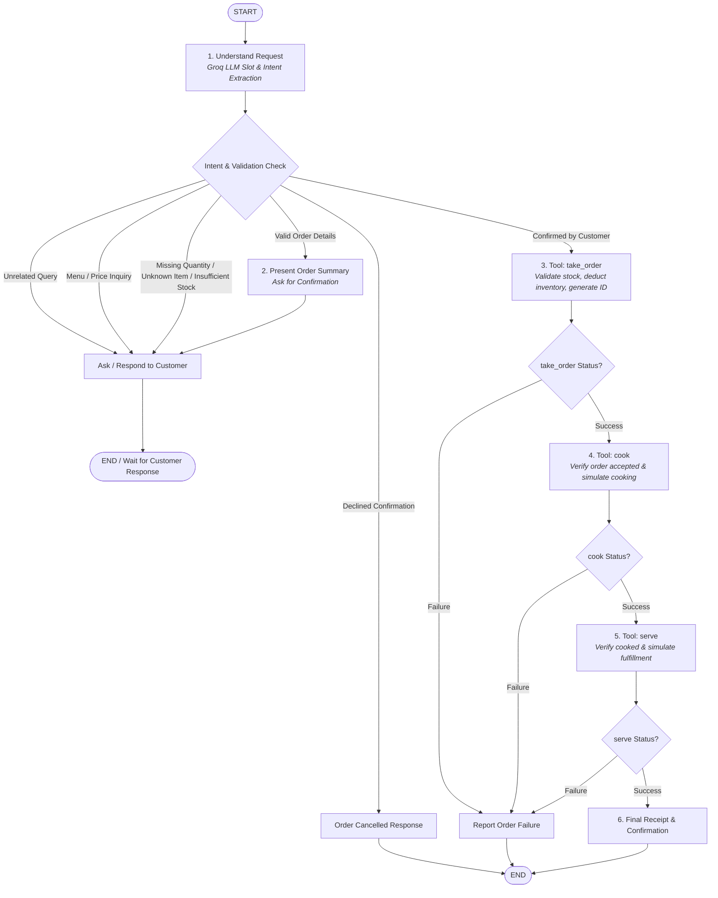

# Restaurant AI Agent

An automated restaurant ordering agent built with **Python**, **Groq** (`openai/gpt-oss-120b`), and **LangGraph**.

The agent processes natural-language food orders, strictly validates them against an authoritative menu and inventory data store, manages human-in-the-loop order confirmations, and reliably enforces the execution sequence `take_order → cook → serve`.

---

## 1. Architecture & Design Principles



### Core Design Guarantees

1. **Zero Price/Inventory Hallucination**:
   - The LLM only parses natural language intent, candidate food item names, and requested quantities.
   - Prices and stock availability are **never** decided by the LLM. They are queried from the authoritative `MENU_INVENTORY` source of truth.
   - If a customer mentions an untrusted price (e.g. *"I want 10 plates of Chicken Butter Masala at 50 rupees each"*), the system ignores the customer-supplied price and calculates the total using the authoritative price from the menu (`10 * 320 = 3200`).
2. **Deterministic Sequence Enforcement**:
   - LangGraph conditional routing strictly enforces:
     $$\text{Confirmation} \longrightarrow \texttt{take\_order} \longrightarrow \texttt{cook} \longrightarrow \texttt{serve}$$
   - If `take_order` fails, `cook` is never invoked.
   - If `cook` fails, `serve` is never invoked.
   - Unaccepted or non-existent orders cannot be cooked. Uncooked orders cannot be served.
3. **Idempotency and Duplicate Protection**:
   - `take_order` tracks `order_id` in `ORDERS_STORE`. Retrying an existing order will not double-decrement inventory.
4. **State Persistence**:
   - Utilizes LangGraph's checkpointer (`MemorySaver`) with conversation thread identifiers (`thread_id`), allowing multi-turn conversations where customers supply missing quantities or confirm orders seamlessly.

---

## 2. Graph Nodes & Edge Explanations

| Node Name | Type | Purpose |
| :--- | :--- | :--- |
| `understand_request` | LLM Node | Invokes Groq (`openai/gpt-oss-120b`) to extract intent (`order`, `inquiry`, `confirm`, `decline`, `unrelated`), food item name, and requested quantity. |
| `validate_order_details` | Deterministic | Validates the extracted slot against `MENU_INVENTORY`. Checks for missing quantity, non-positive quantity, unknown items, and inventory capacity. Computes authoritative total price and formats the confirmation prompt. |
| `handle_inquiry_or_unrelated` | Deterministic | Answers menu questions with live prices/stock, or politely guides the user back to ordering scope when questions are unrelated. |
| `handle_decline` | Deterministic | Gracefully resets the proposed order when a customer declines confirmation. |
| `take_order_node` | Tool Execution | Invokes `take_order`. Verifies inventory, decrements stock, creates order ID, records order. |
| `cook_node` | Tool Execution | Invokes `cook`. Validates order is accepted and cooks it. |
| `serve_node` | Tool Execution | Invokes `serve`. Validates order is cooked and marks it served. |
| `final_response_node` | Formatter | Generates the authoritative customer receipt with order ID, quantity, price, and status, or reports failure details. |

---

## 3. Tool Specifications

### `take_order(item_name: str, quantity: int, order_id: Optional[str] = None)`
- **Validations**: Item exists in menu, quantity is positive integer, quantity $\le$ available stock.
- **Output**: Returns order record with `order_id`, `confirmed_quantity`, `unit_price`, `total_price`, and `order_status="accepted"`.
- **Side effects**: Decrements inventory in `MENU_INVENTORY` and registers order in `ORDERS_STORE`.

### `cook(order_id: str, simulate_failure: bool = False)`
- **Validations**: Order exists in store, order status is `"accepted"`, not already cooked.
- **Output**: Sets `cooking_status="completed"`.

### `serve(order_id: str, simulate_failure: bool = False)`
- **Validations**: Order exists in store, cooking status is `"completed"`, not already served.
- **Output**: Sets `serving_status="completed"`.

---

## 4. Environment Setup & Execution

### Prerequisites
- Python 3.10+ (tested on Python 3.14)
- A Groq API key

### Installation

1. Clone or open the repository in the workspace.
2. Create and activate a virtual environment:
   ```bash
   python -m venv .venv
   # Windows:
   .venv\Scripts\activate
   # Linux/macOS:
   source .venv/bin/activate
   ```
3. Install dependencies:
   ```bash
   pip install -r requirements.txt
   ```
4. Configure environment variables:
   Copy `.env.example` to `.env` and insert your API key:
   ```bash
   cp .env.example .env
   ```
   Add your key:
   ```env
   GROQ_API_KEY=gsk_your_groq_api_key_here
   GROQ_MODEL=openai/gpt-oss-120b
   ```

### Running the Interactive Agent

Launch the CLI assistant:
```bash
python restagent.py
```
Example interaction:
```text
=================================================================
  WELCOME TO THE RESTAURANT AI ORDERING ASSISTANT
=================================================================
Type your message (or 'exit' to quit).

Customer: I want 10 plates of Chicken Butter Masala.

Assistant: You are ordering 10 plates of Chicken Butter Masala at INR 320.00 per plate. The total price is INR 3200.00. Would you like to confirm this order?

Customer: Yes, please confirm.

Assistant: Order ORD-A1B2C3D4 Confirmed & Fulfilled!
- Item: Chicken Butter Masala
- Quantity: 10 plates
- Total Price: INR 3200.00
- Status: Cooked and Served (completed)
Thank you for dining with us! Enjoy your meal.
```

---

## 5. Running the Test Suite

The test suite in `test_agent.py` validates all 15 scenarios from Section 10 of `prompt.md`:
1. Valid order with customer confirmation
2. Order with missing quantity (multi-turn follow up)
3. Unknown menu item (displays menu)
4. Zero or negative quantity rejection
5. Quantity exceeding available inventory (offers available plates)
6. Customer declining confirmation
7. Order-creation failure
8. Cooking failure (stops execution before serve)
9. Serving failure
10. Attempt to cook an unaccepted order
11. Attempt to serve an uncooked order
12. Duplicate order protection (idempotency)
13. Unrelated question handling
14. Menu/availability question without placing order
15. Untrusted/fabricated price rejection (authoritative calculation)

Run all tests:
```bash
python -m unittest test_agent.py -v
```
